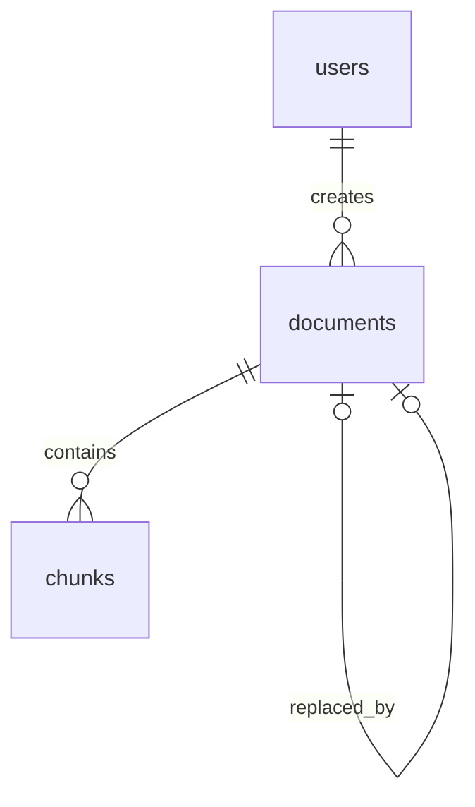

# 第一周数据库字段字典

适用：MySQL 8.0.16 及以上；Java 17；第一周数据库模块。全部表为 InnoDB、utf8mb4。

## users：账号

| 字段 | 类型 | 可空 / 默认 | 含义与约束 |
| --- | --- | --- | --- |
| id | BIGINT | 否 / 自增 | 主键；Java Long |
| username | VARCHAR(64) | 否 | 唯一、非空白、无首尾空格；大小写不敏感、重音敏感 |
| password_hash | VARCHAR(100) | 否 | BCrypt 哈希；数据库检查外形，Java BCrypt 校验密码；禁止回传前端 |
| display_name | VARCHAR(64) | 否 | 非空白显示名称 |
| role | VARCHAR(16) | 否 / USER | USER 或 ADMIN；注册业务必须强制 USER，不能接收客户端角色 |
| enabled | TINYINT | 否 / 1 | 0 禁用、1 可用；是否允许登录由认证业务判断 |
| created_at | DATETIME(6) | 否 / 当前时间 | 创建时间，约定应用连接使用 Asia/Shanghai |
| updated_at | DATETIME(6) | 否 / 自动更新 | 最近修改时间 |

## documents：制度版本

一条记录代表一份制度的一个版本；同一制度的不同版本共用 document_key。

| 字段 | 类型 | 可空 / 默认 | 含义与约束 |
| --- | --- | --- | --- |
| id | BIGINT | 否 / 自增 | 版本记录主键；引用必须指向此 ID，不能只引用制度族 |
| document_key | VARCHAR(80) | 否 | 稳定制度族标识，只允许 ASCII 字母、数字、下划线、短横线 |
| title | VARCHAR(200) | 否 | 文件标题，非空白；演示样例带虚构标识 |
| version | VARCHAR(32) | 否 | 版本标签，非空白；与 document_key 联合唯一 |
| status | VARCHAR(16) | 否 / DRAFT | DRAFT 草稿；ACTIVE 已发布；REPEALED 已废止；采用大小写精确枚举 |
| effective_from | DATE | 否 | 生效日，包含当天；Java LocalDate |
| effective_to | DATE | 是 / NULL | 失效日，不包含当天；必须晚于生效日；NULL 表示未设结束日 |
| replaced_by | BIGINT | 是 / NULL | 指向同制度族后继版本；唯一，避免两个前驱指向同一后继；有关联时必须设失效日 |
| source_type | VARCHAR(16) | 否 | SYNTHETIC 虚构演示 / PUBLIC 真实公开来源 |
| source_url | VARCHAR(1024) | 是 / NULL | 公开来源必须填写非空 URL；URL 的合法性和协议由业务验证 |
| source_note | VARCHAR(500) | 否 | 非空白来源说明；演示数据不是学校正式规定 |
| created_by | BIGINT | 否 | 外键 users.id；用户是否管理员由 Service 验证 |
| created_at | DATETIME(6) | 否 / 当前时间 | 创建时间 |
| updated_at | DATETIME(6) | 否 / 自动更新 | 最近修改时间 |

## chunks：条款

| 字段 | 类型 | 可空 / 默认 | 含义与约束 |
| --- | --- | --- | --- |
| id | BIGINT | 否 / 自增 | 真实 chunkId；Python 必须原样返回，不得自行编号 |
| document_id | BIGINT | 否 | 外键 documents.id，绑定具体版本 |
| chunk_no | INT | 否 | 版本内顺序，必须 > 0；与 document_id 联合唯一 |
| section_path | VARCHAR(200) | 否 | 非空白章节位置，例如“第一章/第三条”；返回字段 sectionPath |
| content | TEXT | 否 | 非空白条款原文；utf8mb4 可存四字节字符 |
| created_at | DATETIME(6) | 否 / 当前时间 | 创建时间 |
| updated_at | DATETIME(6) | 否 / 自动更新 | 最近修改时间 |

## 关系与索引

- users.username 唯一索引：查账号和拦截并发重复注册；注册先查后插仍要处理唯一键异常。
- documents(document_key, version)：同制度族版本唯一。
- documents(id, document_key)：供复合外键保证后继版本属于同一制度族。
- documents(replaced_by)：每个后继最多一个前驱，NULL 可重复。
- documents(status, effective_from, effective_to)：为有效性筛选提供索引候选；失效日含 OR，不能保证全部条件都通过索引完成。
- chunks(document_id, chunk_no)：联查、版本内排序和唯一性共用索引，无需重复添加单列 document_id 索引。
- 小规模演示数据可能选择全表扫描；EXPLAIN 能运行及索引存在，不构成性能提升证据。

## 必须由业务事务保证的规则

普通 CHECK 和外键不能保证跨行时间区间不重叠、后继生效日与前驱失效日相等、版本链无环、已发布版本不可原地修改。新增修订时，Service 应在同一连接的事务内锁住该制度族全部记录，检查区间和版本链，再新增版本、条款并更新前驱。全新制度族没有可锁记录，需统一创建入口并处理唯一键冲突与重试。

默认检索条件：status = ACTIVE 且 effective_from ≤ 查询日，且 effective_to 为空或查询日 < effective_to。replaced_by 只说明替代关系，不单独决定当前有效性；不能按版本字符串最大值选版本。

发布版原则上只读；修订新增版本和条款。废止由业务将目标版本设为 REPEALED。历史浏览可以查所有版本，默认候选查询必须过滤。删除受外键限制，无自动级联删除。

## 初始样例与边界

固定验收日期为 **2026-10-30**，避免运行日期变化导致用例漂移。

| ID | 制度 / 版本 | 分类 | 10/30 是否进入候选 |
| --- | --- | --- | --- |
| 101 | 奖学金 / 2025 | 旧版，9/1 结束 | 否 |
| 102 | 奖学金 / 2026 | 现行，11/1 结束，后继 103 | 是 |
| 103 | 奖学金 / 2027 | 11/1 生效 | 否；11/1 当天是 |
| 104 | 助学金 / 2026 | 现行 | 是 |
| 105 | 困难补助 / 2024 | 已废止 | 否 |
| 106 | 勤工助学 / 2025 | 10/30 失效 | 否；10/29 当天是 |
| 107 | 申诉 / 2026 | 现行 | 是 |
| 108 | 优秀学生 / draft | 草稿 | 否 |

8 份版本记录，每份 5 条，共 40 条；10/30 返回 15 条。演示文本由本次任务构造，尚未接收到戴月原始样例，后续对接应保留来源和字段核对。
